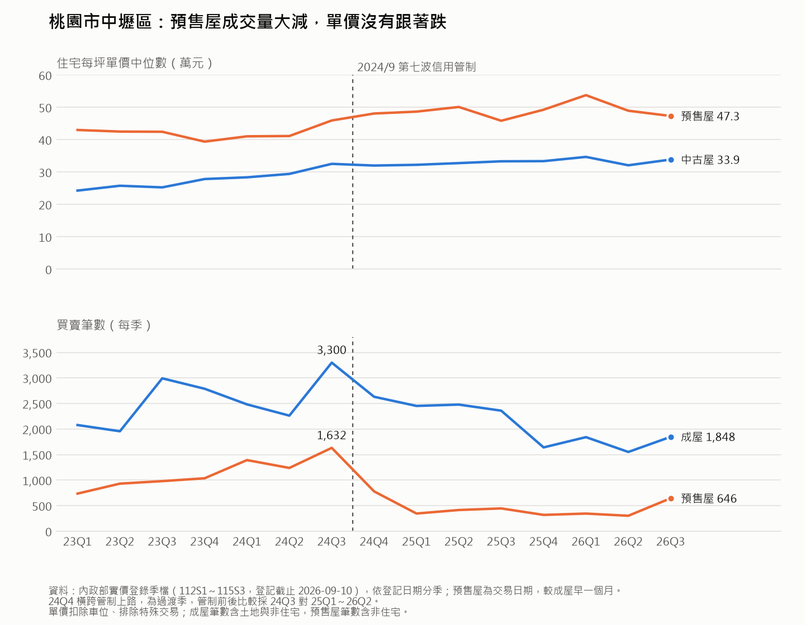

# 台灣房地產市場追蹤

用公開資料持續追蹤全台房市的量、價、政策與供給，並把整理資料的流程自動化。這是我為房地產市場研究準備的作品集專案。

## 主要發現

以交易量全台最大的桃園市中壢區為例，用 2023～2026 年共 15 季的實價登錄季檔觀察 2024 年 9 月央行第七波信用管制前後的變化（[分析程式](analysis/zhongli_trend.py)）：



> **資料範圍**：實價登錄季檔 112S1～115S3，登記期間 2022-12-11～2026-09-10（資料截止日 2026-09-10）。季別以登記期間結束月份命名，例如 2024 Q3 為 2024-06-11～09-10 登記的案件。
>
> **管制前後的切分**：管制前高點為 2024 Q3；2024 Q4（2024-09-11～12-10）橫跨管制上路，視為過渡季不納入比較；「之後六季」指 2025 Q1～2026 Q2；最新一季 2026 Q3 單獨列出，不併入平均。

1. **量縮價撐：預售屋成交量少了近八成，單價沒有回檔。** 預售屋買賣筆數從管制前高點 2024 Q3 的 1,632 筆，降到之後六季平均 363 筆（−78%）；同期預售屋每坪單價中位數維持在 46～54 萬、中古屋在 32～35 萬，都維持在管制前高點附近或更高。預售屋單價中位數會受當季成交的建案組合影響，中古屋則會受屋齡結構影響，建案層級與屋齡帶的分群檢查待補。同期還有利率與其他政策變動，這裡只呈現時間上的前後變化，不推論單一政策的因果。
2. **買氣從預售屋轉回中古屋。** 中古屋占住宅成交的比例，從管制前的 50～59% 升到管制後的 66～74%；成屋買賣筆數只減少 38%，跌幅遠小於預售屋。最新一季（2026 Q3）預售屋回升到 646 筆、中古屋比例回落到 57%，是否代表預售市場回溫，還要再觀察一到兩季。

## 為什麼做這個專案

市場研究要回答的是同一類問題：這一區的需求撐不撐得住？價格還有沒有空間？未來幾年會有多少新供給進來？什麼樣的客群在進場？要回答得有說服力，靠的不只是個別成交案例，還要能把實價登錄、央行政策、總體經濟和建照使照供給串在一起看。

這個專案想練的就是這件事：

- 定期蒐集資料，累積成可以回頭比較的時間序列，而不是每次都從頭查
- 從市場研究的角度判讀數字，例如政策調整後哪些客群、哪些區域最先受到影響，以及對推案時機與產品定位的意涵
- 把觀察整理成可以拿到面試或會議上講的論點，並說得出要用什麼資料來驗證

## 資料來源

| 類別 | 來源 | 內容 |
|---|---|---|
| 成交資料 | 內政部不動產交易實價查詢服務網 | 實價登錄買賣、預售屋交易明細 |
| 金融與利率 | 中央銀行 | 重貼現率、理監事會議決議、房貸餘額、五大銀行新承做房貸利率、M2 |
| 總體經濟 | 主計總處 | 經濟成長率、CPI、失業率、經常性薪資 |
| 景氣 | 國發會 | 景氣對策信號分數與燈號 |
| 供給面 | 內政部統計處、營建署 | 建照、使照核發宅數與樓地板面積 |
| 業界觀點 | 信義、住商、永慶、台灣房屋、中信房屋、有巢氏等 | 房價指數、季報、購屋民調 |
| 新聞 | 經濟日報、工商時報、聯合新聞網 | 市場動態與政策報導 |

官方資料優先；只有在官方查不到時才採用媒體轉述的數字，並在來源欄註明。

## 資料夾說明

```
Real-estate/
├── README.md
├── GITHUB_ACTIONS.md        雲端排程（GitHub Actions）設定說明
├── SCHEDULE.md              本機排程（Windows 工作排程器）設定說明
├── .github/workflows/       三個雲端排程 workflow
├── prompt_news.md           新聞整理的指令
├── prompt_data.md           實價登錄處理的指令
├── prompt_indicators.md     總經與建照使照指標的指令
├── run_news.ps1             排程用腳本（以下三支同）
├── run_data.ps1
├── run_indicators.ps1
├── data/
│   ├── raw/                 實價登錄原始 zip，依季分資料夾（不進版控）
│   ├── district_metrics.csv 各縣市、行政區的量價與屋齡指標
│   └── macro_supply.csv     總經指標與建照使照數據
├── reports/                 每期產出的新聞摘要與指標更新紀錄
├── analysis/                資料處理腳本（process_lvr.py）、分析筆記本與圖表
└── logs/                    排程執行紀錄（不進版控）
```

`district_metrics.csv` 與 `macro_supply.csv` 都是只增不改的長表格式，每列是一個「期間 × 地區 × 指標」的數值，方便之後直接用 pandas 做樞紐或畫時間序列。

## 更新頻率

| 項目 | 頻率 | 產出 |
|---|---|---|
| 房市新聞摘要 | 每週一、四 | `reports/news_YYYY-MM-DD.md` |
| 實價登錄指標 | 每月 1、11、21 日（配合實價登錄每旬更新） | `data/district_metrics.csv` |
| 總經與建照使照 | 每月 5、25 日 | `data/macro_supply.csv`、`reports/indicators_YYYY-MM-DD.md` |

三項更新都用 GitHub Actions 在雲端自動執行，設定方式見 [GITHUB_ACTIONS.md](GITHUB_ACTIONS.md)；實價登錄由 workflow 自動下載後用 Python 處理，不經過 AI。

## 之後預計做的分析

### 1. 建照領先使照的時間差

建照代表建商決定蓋，使照代表房子蓋好可以交屋，中間通常隔了好幾年。想看的是：

- 全國與六都的建照宅數，大約領先使照多久（用交叉相關找最適落後期數）
- 時間差在不同縣市是否不一樣，例如新北、桃園這類大量推案的區域
- 用現在的建照量推估未來幾年的完工潮，哪些地區可能出現交屋量集中的壓力

### 2. 房貸利率與成交量的關係

- 五大銀行新承做房貸利率、央行升降息與信用管制，和全台及各縣市買賣成交筆數的關係
- 利率變動後，成交量大約多久會出現反應
- 政策衝擊（例如選擇性信用管制、青安貸款調整）前後，首購與投資型區域的成交量變化是否不同

### 3. 單一行政區的量價與屋齡分析

挑一個交易量夠大的行政區深入看：

- 成交量與每坪單價中位數的長期走勢，量價是同步還是背離
- 中古屋與預售屋的價差與成交比例變化
- 不同屋齡帶（5 年內、5～20 年、20 年以上）的單價差異，以及買氣往哪一段集中
- 最後整理成一份「如果要在這一區推案，該怎麼定價、抓推案時機」的簡報

> 已完成：桃園市中壢區的量價走勢與管制前後比較，結論見上方「主要發現」。屋齡帶與價差的細部分析待補。

## 工具

- 資料整理：Python（pandas）
- 資料蒐集與摘要：Claude Code（新聞與指標的搜尋、判讀）
- 自動化：GitHub Actions 定期執行，產出自動 commit 回 repo
- 視覺化：matplotlib，圖表放在 `analysis/figures/`
